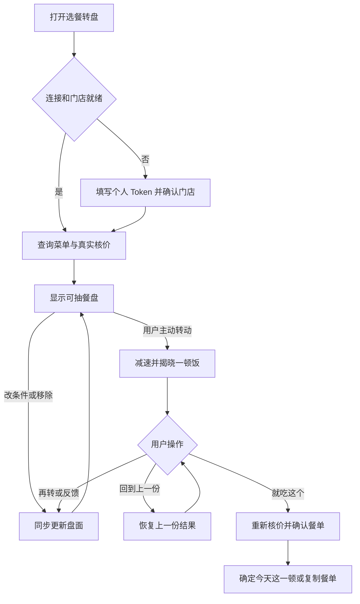

# 今天这顿，转一下

麦当劳选餐转盘 · 产品与交互设计文档 v1.1  
日期：2026-10-23  
用途：作为参赛第一版实现和验收依据；产品暂用名，可后续更换。

本次更新：确定纯前端 Web 优先直连真实 MCP；首版停在选餐与核价，不创建订单；加入条件筛选后盘面同步更新、点击或拖出移除、撤销及本轮排除规则。浏览器跨域兼容性仍待实测。

## 1. 产品要解决的问题

让一个不知道吃什么的人，用最少的精力，得到一个愿意接受的答案。

目标场景是：用户已经愿意吃麦当劳，但不知道这一顿怎么选。第一版不解决跨品牌、跨菜系的“今天到底吃什么”。

价格和忌口用于筛选可接受范围，用户也能直接从转盘移除这顿不想吃的组合。首版用真实核价提供价格依据，产品核心是帮助结束选择。

### 核心体验假设

用户主动转动转盘，经历等待、减速和揭晓后，可能比直接看到系统推荐更愿意接受结果：这是“我亲手抽中的今天这一顿”。

这是待验证的产品假设，不能当成已被证明的心理规律。抽到结果后接受它，或明确发现自己想吃别的，都可以让选择向前推进。

### 设计原则

1. 先有用户主动启动的转盘动作，再展示最终结果；不以首页推荐卡替代转盘。
2. 每次只给一顿完整的饭；不在结果页并列摆出多套方案。
3. 条件可选、设置可记忆；不先发问卷，不把解释拒绝原因设为必填。
4. 随机只发生在实际可购买、符合已知条件的候选内。
5. 用户随时可以再转、修改条件或回到上一份；不以“命中注定”施压消费。
6. 抽中与接受是不同状态；首版不创建订单、不支付，不把接受方案描述为已购买。
7. 条件变化必须反映在盘面；手动移除后不自动补入新组合，允许候选逐渐减少。

## 2. 第一版范围

| 项目 | 第一版决定 |
|---|---|
| 人数 | 单人用餐 |
| 品牌 | 麦当劳中国 MCP 可支持的餐品 |
| 方式 | 当前门店、现在到店取餐；外送留到后续 |
| 入口 | 手机优先的纯前端 Web，桌面浏览器也可使用，可静态托管 |
| 选餐 | 有条件的随机转盘、点击或拖出移除、撤销、结果卡、再转、回到上一份 |
| 反馈 | 可选快捷原因；首版采用前端规则，不依赖大模型或聊天 |
| 接受 | 接受后重新核价、确认完整餐单，可复制餐单供用户自行购买 |
| 记忆 | 本地保存预算、明确忌口和常用门店；手动移除仅本轮生效，提供清除入口 |
| 技术 | 浏览器 JS 处理界面、候选和 MCP 协议；无业务后端、数据库或自建账号系统 |
| 暂不做 | 下单与支付、外送、饭量独立筛选、大模型自由文本理解、多人拼单、全菜单最优价、积分商城、人格测试、桌宠、消费报告、跨品牌推荐 |

纯前端网页是本次讨论已确定的优先形态。候选筛选与 MCP 客户端模块和界面分离，便于调试与未来复用。跨域不通时才考虑薄代理，不预先扩展为完整后端。比赛作品需要真实使用 MCP；纯模拟转盘只作为演示入口，不能代替真实接入。

## 3. 完整用户流程

首次连接是必要成本，不能用模拟价格掩盖尚未接入的状态。可先以演示模式体验转盘，使用明确标注的样例、无需 Token；切换真实模式后必须查询实际门店、餐品和价格。首版结果不生成支付链接，不承诺餐单能自动导入官方购物车。

## 4. 页面与交互

### 4.1 首页：转盘是主角

从上到下：

- 标题：“不知道吃什么？转一下。”
- 门店条：当前门店名称、到店取餐、修改入口。
- 中央转盘：展示餐品小图和主餐名称，点击某格可查看完整组成并选择移除，但不要求逐格浏览。
- 主按钮：“今天吃这个”，也可点击转盘中心触发。
- 下面只放两个可选条件：预算、不吃什么；使用紧凑按钮，复杂设置放入底部面板。
- 次要入口：连接设置、隐私与清除数据。

预算选项：不限、20 元内、30 元内、自定义。首次默认不限，不擅自替用户设预算。

忌口支持如“不辣”“不吃牛肉”等偏好。无法从官方信息确认的限制，不宣称已满足；涉及过敏原时需要明确提醒核对官方信息。

第一版不增加独立饭量筛选项，默认生成正常单人餐组合；“分量不合适”可作为结果后的临时反馈。份量规则只是搭配启发，不等于饱腹或营养保证。

老用户沿用本机上次设置，始终在首页可见、可改。换门店后重新获取菜单和价格。

### 4.2 筛选与手动编辑转盘

**条件改变后，转盘同步更新，禁止只改标签、不改实际抽选范围。** 调整预算或忌口时先从已核价、仍有效的餐盘池中筛选，退出不符合条件的格子，剩余格子重新均分盘面。需要新查询或重新核价时，立即显示“更新餐盘中”并禁用转动；完成后一次性替换盘面，旧请求不能覆盖新条件。

| 操作 | 交互及结果 |
|---|---|
| 调整预算 | 超预算组合退出；放宽预算时，可恢复基础候选池中符合条件的组合 |
| 选择不吃牛肉等条件 | 移除含该成分的组合；无法确认满足条件的组合不参与抽取 |
| 点击某格 | 高亮并打开小卡，展示组成和“这顿不想吃 ×”；点击移除按钮才执行，避免误触 |
| 拖出盘外 | 被拖项跟随手指或鼠标，跨过明确的盘外移除区域时显示提示，松手移除；未跨过则回弹 |
| 移除成功 | 格子退出，其余格子重新排布；底部提示“已移除 · 撤销” |
| 撤销 | 恢复最近一次手动移除；若当前条件不再允许，说明原因并保留排除记录 |
| 恢复本轮移除 | 清除本轮手动移除集合，仍遵守当前预算、忌口及可售条件 |

移动端以点击移除为主要方式，拖出为快捷方式。拖动开始需有位移阈值，开始后捕获指针；仅在转盘操作区域处理拖拽，避免整个页面无法滚动。转盘本身不通过拖拽旋转，中心按钮负责启动抽取。键盘用户可聚焦餐品并使用同一移除按钮。

**手动移除后不自动补位，也不每次重新生成另一批餐品填满转盘。** 让用户排除后候选逐渐减少。预算或忌口变化属于重新筛选基础池，但本轮已经手动移除的组合仍应排除，避免刚删掉就回来。

手动移除的单位是完整组合；移除一次不等于永久不吃该主餐或原料。只有明确勾选“不吃牛肉”等偏好才按原料排除并保存。

仅剩一份时显示“只剩这一份啦”，提供查看与接受入口，不播放虚假的多选转盘。全部手动移除时显示“这轮都不想吃？”，提供“恢复本轮移除”与“调整条件”。没有任何组合满足硬性条件时，不靠恢复操作绕过条件。

### 4.3 转动过程

候选准备好前，主按钮显示“准备今天的餐盘”，完成后才允许转。转动期间锁定本次候选、条件及移除操作，禁用重复点击，避免动画、盘面和抽选结果不一致。

正常动画建议先以 2.5–3.5 秒为起点调试：启动、稳定旋转、减速、停下、结果放大。具体时长是试验参数，不是已确认结论。声音默认关闭，可开启轻微刻度音；尊重系统减少动态效果设置。

每格等权，结果先由随机算法从本轮候选中选出，再计算指针准确落点。前端抽取不因商业利益偷偷改变概率。若以后采用加权抽取，应明确说明规则，并让视觉面积与概率一致。

不得把接口等待伪装成无限转动。若准备请求慢，在转动前展示等待状态和重试入口。

### 4.4 结果页

文案：“转到了！今天这顿就它吧。”

展示一份大图、完整餐品组成与数量、当前核价金额、门店、取餐方式。组合没有官方合照时，使用真实单品图片拼排，不用生成图片冒充实物。

主要按钮：**就吃这个**、**再转一次**。

次要入口：还是上一份、调整条件、可选拒绝原因。第一版提供“太贵”“不想吃炸的”“想换个肉”“分量不合适”等规则化快捷反馈，不要求输入自由文本。用户不选择原因也能直接再转。

不给长篇推荐理由，不展示“你可能还喜欢”的列表，不在此处加购推荐。

### 4.5 接受与确认餐单

“就吃这个”表示接受方案，不创建订单、不扣费。

接受后重新核价，展示门店、到店取餐、完整餐品和规格、数量、适用优惠、最终金额及核价时间。金额变化时展示前后差异；超过原预算不能默认接受。售罄或配置失效时，提示调整或重抽，不静默替换商品。

确认页主按钮：“就定这顿了”，次要按钮：“复制餐单”“回到转盘”。复制的是可读的餐品、规格、数量、门店与参考报价，供用户在官方渠道自行购买，不声称已创建订单或已同步购物车。

未来接入下单时再增加明确的订单确认与支付步骤；不纳入首版验收。

## 5. 候选餐盘怎样生成

### 5.1 一个候选就是一顿饭

例如：一份鸡肉汉堡、一份小食、一杯饮品。仅表示组合结构，具体餐品、规格、价格必须来自当前门店接口。

优先采用官方完整套餐，并按套餐详情补全必须选择的子项。自组搭配仅使用经过验证的组合模板，避免出现两杯饮料当午餐、数量异常或套餐子项遗漏。

初始建议展示 6–8 格。候选应在主餐、烹饪方式、口味上有差异，不能用同套餐换几种饮料凑满转盘。6–8 是实现起点；不足时减少格数，不复制候选冒充多样性。

### 5.2 筛选和核价顺序

1. 获取当前时间、门店状态、当前可售菜单、套餐详情和门店适用优惠。
2. 按正常单人餐模板准备基础组合池，并按完整商品配置去重；应用预算和明确忌口约束。
3. 选取有差异的少量组合，调用官方价格计算；不把全菜单组合全部穷举核价。
4. 只把核价成功、满足预算、组成完整的方案放进转盘。
5. 从基础池应用当前条件及本轮手动排除，显示盘面；用户主动转动时冻结候选版本，再等权随机选出结果。
6. 用户接受后再次核价，处理价格与供应变化。

所有显示金额统一按接口明确单位处理，不根据字段名猜测元或分。示例价格不能回填到真实结果中。

首版不依赖大模型：MCP 数据由浏览器 JS 查询，候选生成、筛选、金额归一化、快捷反馈及随机抽取由前端规则处理。后续如增加自然语言反馈理解，再单独评估大模型接入。

### 5.3 再转与反馈规则

| 用户行为 | 下一轮处理 |
|---|---|
| 直接再转 | 本次抽取不重复刚才组合，优先切换主餐；与手动排除分开记录，不推断永久不喜欢。不足两个可抽选项时解释原因，不悄悄恢复手动移除项 |
| 手动移除 | 从本轮候选移除完整组合，不自动补位；预算与忌口变化后仍保留排除，直到撤销、恢复或开启新一轮 |
| 不想吃炸的 | 本次会话排除可确认的油炸主餐，无法确认的组合不进入候选 |
| 想换牛肉 | 本次会话筛选牛肉主餐，保留原预算和明确忌口；冲突时先提示 |
| 太贵 | 展开预算快捷选项，让用户一键降低；不自行猜具体上限 |
| 分量不合适 | 让用户点“少一点”或“多一点”，只调整本轮饭量 |
| 还是上一份 | 恢复前一份结果；若被手动移除则需用户撤销该移除，若违反当前硬性条件则先调整条件；不能静默绕过筛选 |

预算、明确忌口及常用门店保存在本机；手动移除、重抽记录与临时反馈默认仅当前一轮生效，不因一次拒绝写成永久偏好。“新开一轮”清除临时状态并保留已保存条件。刷新页面默认开始新一轮；上一份结果仅本轮保留，接受时重新核价。

## 6. MCP 接入设计

官方接入地址：`https://mcp.mcd.cn`；使用 Streamable HTTP 和个人 Bearer Token。

以下根据此前读取的官方说明整理，属于工具职责映射。实施前必须通过当前 `tools/list` 校验名称、输入 schema、金额单位和返回结构；本文不杜撰可直接执行的请求参数。

| 工具 | 本产品用途 |
|---|---|
| `now-time-info` | 确认当前时间与餐段 |
| `query-nearby-stores` | 查询并让用户确认门店 |
| `query-meals` | 获取当前门店可售餐品 |
| `query-meal-detail` | 获取套餐组成、规格、必选项及替换信息 |
| `query-store-coupons` | 获取当前门店适用优惠；不将账户所有券都视为可用 |
| `calculate-price` | 候选和接受后的餐单真实核价 |
| `list-nutrition-foods` | 可选，辅助餐品标签；首版不做精确热量目标 |

优惠优先使用已可用的门店优惠；首版不主动领券、不做复杂券排程，不以省钱理由推荐用户多买。无法验证的优惠不计入应付价。

### 纯前端技术结构

数据流：**浏览器网页 JS → 麦当劳官方远程 MCP → 菜单、详情、优惠与核价结果 → 本地候选池与转盘**。

前端拆分为：转盘组件、筛选与移除状态、餐单组合规则、MCP 客户端、官方响应适配、报价缓存、偏好存储。数据来自真实 MCP，不代表必须使用大模型。

无需自建业务后端、数据库或登录系统。可静态托管，但本地开发也应通过 HTTP 开发服务器访问，避免用 file:// 页面作为兼容性判断依据。

### 开发第一步：验证浏览器直连

目前尚未实测麦当劳 MCP 对浏览器跨域请求的支持，不能宣称纯前端链路已经跑通。协议兼容性需查当前官方文档，并以真实浏览器请求验证：

1. 从预期网页来源发起请求，检查跨域预检是否允许该来源、POST 及使用到的请求头。
2. 按当前 MCP 协议完成初始化及必要的握手通知，再调用 tools/list 获取实际 schema。
3. 验证 Authorization、Content-Type、Accept，以及实际需要的 MCP 协议版本和会话请求头；若服务返回会话 ID，跨域响应必须允许 JS 读取并在后续请求携带。
4. 解析服务实际使用的 JSON 或流式响应，跑通一个查询、菜单查询与 calculate-price；在拟部署域名再次验证。
5. 区分鉴权失效、业务错误、网络失败及浏览器跨域拦截；不把命令行请求成功当成浏览器可用的证明。

若浏览器直连失败，先确认是否可通过官方配置或支持方式解决。服务不开放所需 CORS 时，纯前端无法绕过；届时才评估同域薄代理，并更新文档与部署说明。不得使用 mode: no-cors 冒充可读响应，不让用户关闭浏览器安全限制。

### Token 与本地状态

Token 由用户自行填写，默认仅保存在当前页面内存，刷新后重新连接；不默认长期保存到 localStorage，不写源码、URL、日志或分析事件。网页只向官方 MCP 地址发送凭证，示例配置仅用占位符，断开连接后清除。

预算、明确忌口和常用门店可用 localStorage 保存，和凭证分开处理。手动排除集合、当前及上一份结果、临时反馈放在本轮内存状态。演示模式不读取真实凭证、不发送真实请求。

首版不调用 create-order、取消、领券、积分兑换等修改账号状态的工具；“复制餐单”也不触发这类调用。

## 7. 内部数据与状态

以下是本产品内部字段，不是官方 MCP 参数。

| 对象 | 必要信息 |
|---|---|
| 偏好 | 预算上限（整数分或不限）、明确忌口、常用门店、偏好来源 |
| 餐盘 | 内部 ID、官方商品编码、子项配置、数量、图片、可核实标签、去重签名 |
| 报价 | 门店、餐盘签名、优惠引用、应付整数分、官方响应依据、核价时间 |
| 转盘会话 | 基础餐盘池、可见候选与版本、本轮手动排除集合、撤销栈、当前及上一份结果、临时反馈、重抽记录 |
| 界面状态 | 未连接、加载中、可编辑、转动中、展示结果、接受后核价中、已确定餐单、失败 |

变更预算、忌口、门店后，旧候选版本失效。开始转动时冻结本轮版本，禁止异步返回覆盖已经抽中的餐盘。基础池、手动排除与临时重抽排除独立维护。条件切换后先过滤，再原子更新盘面与抽选集合；撤销不能恢复违反当前硬性条件的项。展示数据缺失时不以零价格、空餐品或默认已购买兜底。

## 8. 异常与边界

| 情况 | 用户看到什么、可以做什么 |
|---|---|
| 未连接 / Token 失效 | 连接或重新连接入口；保留本地偏好，不显示真实结果已就绪 |
| 门店关闭 | 提示更换门店，不用旧菜单继续抽 |
| 无候选满足条件 | 明确说明，提供调预算或修改条件；不自动放宽忌口 |
| 仅剩一个有效候选 | 显示“只剩这一份啦”，直接查看；不伪造随机感 |
| 全部手动移除 | 显示“恢复本轮移除”与“调整条件”，不自动补位 |
| 撤销项与新条件冲突 | 说明无法恢复的原因，保留排除记录，可先调整条件 |
| 浏览器跨域不通 | 显示连接兼容问题，演示仍可使用；不冒充真实菜单已加载 |
| 仅有 2–5 个候选 | 以真实数量呈现转盘，不补重复格 |
| 核价部分失败 | 成功候选足够时继续；不足时提示重试或改条件，不编造价格 |
| 图片缺失 | 用统一餐品占位图和名称，避免假图 |
| 接口限流 / 网络失败 | 有界退避处理查询与核价，提供重试；不无限重试，不重复初始化造成请求风暴 |
| 接受后核价变贵或售罄 | 说明变化并重新确认或回到转盘，不能静默换商品 |
| 用户连续拒绝 | 约三次后轻提示“哪里不对胃口？”并给可选反馈，仍允许跳过 |

## 9. 视觉与文案方向

整体轻松、有食欲，转盘为视觉中心。使用暖色、清晰食物图和克制的揭晓动效，避免满屏闪光、中奖金额、稀有度诱导。

建议文案：

| 场景 | 文案 |
|---|---|
| 首页 | 不知道吃什么？转一下。 |
| 转动按钮 | 今天吃这个 |
| 揭晓 | 转到了！今天这顿就它吧。 |
| 接受 | 就吃这个 |
| 重抽 | 再转一次 |
| 回退 | 还是上一份吧 |
| 可选反馈 | 不对胃口？告诉我一点点就好。 |
| 移除 | 这顿不想吃 × |
| 移除成功 | 已移除 · 撤销 |
| 全部移除 | 这轮都不想吃？恢复本轮移除 / 调整条件 |
| 确定餐单 | 就定这顿了 |
| 保存结果 | 复制餐单 |

“命中注定”是趣味氛围，不宣称运势，不保证抽出的就是用户最佳选择。页面标注独立参赛作品，避免暗示麦当劳官方产品。

## 10. 验证目标与验收标准

### 先验证是否帮助结束选择

核心观察：从候选就绪到用户接受用了多久、接受前转了几次、手动移除了几项、是否撤销、多少人离开，以及接受后是否确定或复制餐单。首次连接耗时与选餐耗时分开统计。

“抽中了”“就吃这个”“就定这顿了”“复制餐单”分别记录；复制不等于已购买。首版可在本机记录试用事件或人工观察，无需建设分析后端。转动次数高不直接算成功，用户换了方向后在别处决定，也可通过访谈了解，不能凭页面事件猜测。

先请 5–8 位确实有选餐纠结的人试用，观察是否理解转盘、是否愿意接受、哪里产生额外思考。这是定性试用，不能据此宣称统计显著。暂不设凭空的转化率目标。

### 第一版验收清单

- [ ] 首屏以转盘为中心，未经用户启动不会直接给出最终推荐。
- [ ] 不要求填写问卷；首页仅预算、不吃什么两个可选条件，可跳过、可修改。
- [ ] 改条件后盘面与实际抽选集合同步更新，异步旧响应不能覆盖新条件。
- [ ] 点击餐品后可明确移除，拖出盘外可移除，移动端滚动与拖拽无冲突。
- [ ] 手动移除不自动补位；支持撤销、恢复本轮移除，并继续遵守硬性条件。
- [ ] 剩一份、全移除和无符合条件组合三种状态分别正确呈现。
- [ ] 转盘每格对应完整、唯一、成功核价且符合当前约束的餐盘。
- [ ] 动画停下的格子与结果卡一致，转动期间无法修改或移除格子。
- [ ] 再转无需说明理由；可选反馈能实际改变下一轮候选。
- [ ] 可恢复上一份；新约束冲突、价格过期时有明确处理。
- [ ] 接受后重新核价，金额变化和超预算需要重新确认。
- [ ] 首版不调用下单、支付、领券等写操作，接受结果不显示已购买。
- [ ] 演示模式明确标注，模拟价格不会混入真实餐单或报价。
- [ ] 实际浏览器从部署来源完成 MCP 握手、工具发现、菜单查询与核价，验证 CORS、会话和响应解析。
- [ ] 移动端可操作、减少动态效果模式可用、主要按钮有文字与焦点状态。
- [ ] 真实凭证和原始个人订单不进入日志、仓库或演示材料。

建议实现顺序：先验证浏览器跨域、MCP 握手及真实菜单核价 → 前端生成基础候选池 → 实现条件同步筛选和移除撤销 → 实现转盘、结果与回退 → 接受后重新核价与复制餐单。演示模式可在开发过程中使用，但必须标注，不能替代参赛作品的真实 MCP 接入。

## 11. 参考与决策来源

- [Tiny Decisions 小决定](https://apps.apple.com/us/app/tiny-decisions-spin-wheel/id1338769645)：参考用户主动转动、等待与揭晓的决策仪式。
- [中文“今天吃什么”](https://www.digitalorigin.tw/tools/what-to-eat/)：参考在可接受名单里抽取，以及对结果的拒绝帮助显露偏好。
- [麦当劳 MCP 官方接入指南](https://github.com/M-China/mcd-mcp-server)：工具职责与接入方式；当前 schema 以实际服务为准。
- [麦当劳开发挑战赛](https://github.com/M-China/mcd-developer-innovation-challenge)：参赛背景。

本设计来自本次讨论中已认可的方向：选择是主痛点；用户主动启动转盘；抽出完整的一顿饭；筛选后更新盘面；支持点击或拖出移除；轻松重抽与回退；纯前端优先直连真实 MCP；首版停在选餐与核价。格数、动画时长和具体动效为可调整实现建议。

## 12. 修订记录

| 版本 | 日期 | 变更 |
|---|---|---|
| v1.0 | 2026-10-22 | 初始产品与交互设计 |
| v1.1 | 2026-10-23 | 改为纯前端直连优先；删除首版后端、下单与支付；补充 CORS 验证、筛选同步、点击/拖出移除、撤销和本轮状态规则 |
